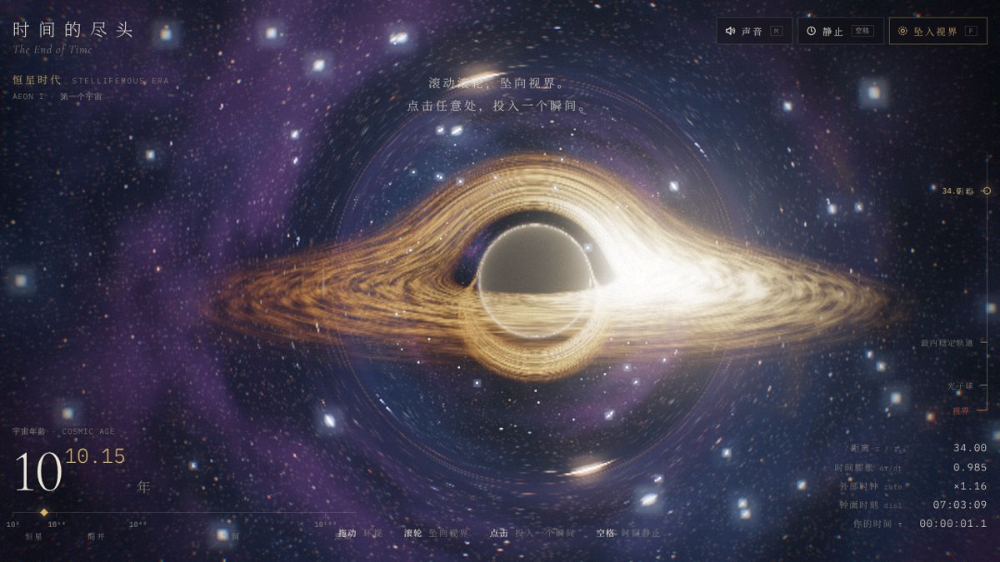
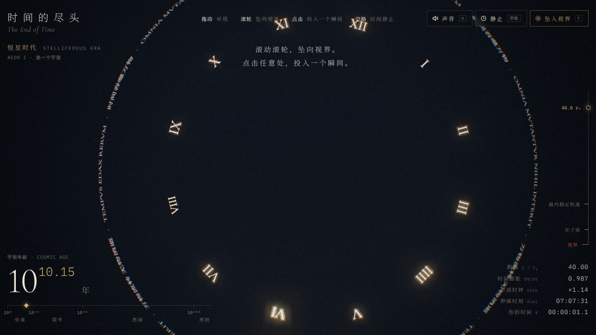
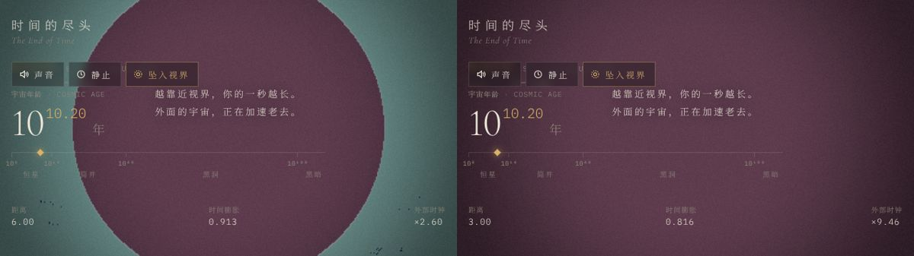
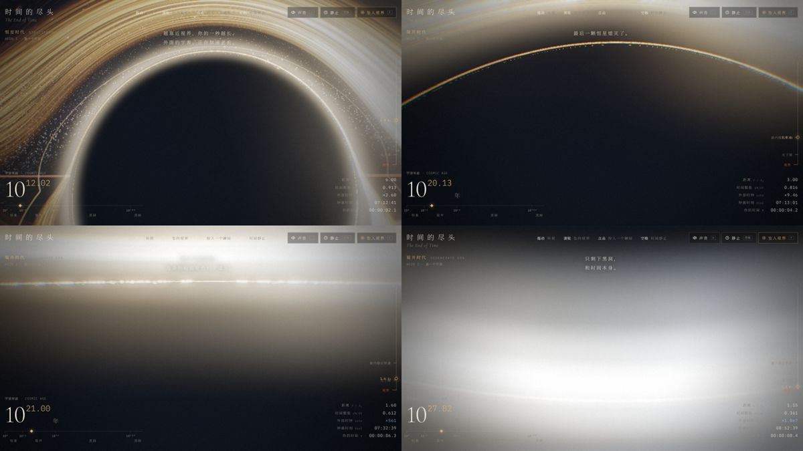
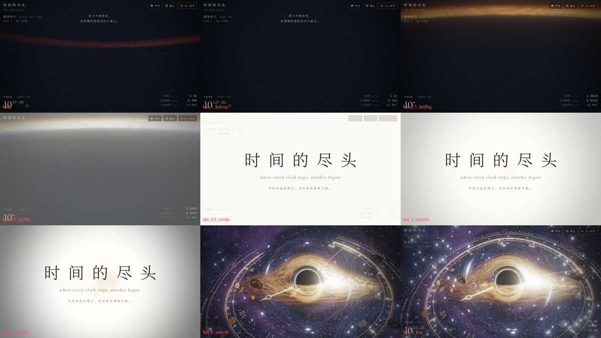

# 制作过程 · THE END OF TIME

这份记录写给以后做新作品的人：这件作品从一句题目开始，经过哪些版本、在哪里卡住、最后怎么解决。能复用的结论整理在 [docs/lessons.md](../../docs/lessons.md)。

## 0. 题目与立意

题目只有一句「时间的尽头」，没有其他限制。先把它拆成三个能被看见的东西：

1. **时间会停下的地方**：黑洞视界。从外面看，落进去的东西永远停在视界上；悬停在视界附近的人，看外面的时钟飞快地走。这是广义相对论里真实存在的「时间的尽头」。
2. **宇宙的结局**：恒星熄灭、质子衰变、只剩黑洞的黑暗时代（Adams & Laughlin 的五个纪元）。
3. **时钟本身**：让黑洞成为一座宇宙时钟的轴心，表盘、指针、齿轮都绕着它转。

三者用同一个机制串起来：**你离视界越近，外部时钟走得越快，宇宙老得越快。** 下坠这个动作既是操作，也是叙事。越过视界后白光淹没，下一个宇宙开始，体验首尾相接，可以一直玩下去。

## 1. 技术路线

- 黑洞不用贴图或假的光环，而是逐像素积分光线（Schwarzschild 测地线）。吸积盘的「帽子」、光子环、多普勒集束都是算出来的，转到任何角度都成立。
- 光线追踪只能画背景。表盘、齿轮、尘埃是三维物体，要和背景一致地弯曲，就在顶点着色器里做弱场点透镜：把每个顶点移到它的像所在的位置。
- 光线追踪最贵，单独渲染到低分辨率目标再放大，画质自适应主要调它。
- 声音全部 Web Audio 合成，滴答声和画面上的外部时钟同步。

原型是一个单文件 HTML（Three.js 从 CDN 载入），快速迭代画面；定稿后再按图鉴规范拆成模块，接入 Atlas UI。

## 2. 迭代记录

每次改动后都在无头浏览器里截图检查。这台机器没有 GPU，用的是 SwiftShader 软件渲染，实时循环下截图会超时，所以加了一个 `?manual` 模式：停掉动画循环，由测试脚本调用 `advance(秒)` 推进模拟、`draw()` 渲染一帧。

### 第一版：一片白雾

第一张图几乎全白：尘埃粒子的半径分布写成了 `r = R(1−u)^0.4`，面密度随半径**增大**（Σ ∝ r^0.5），整个画面被外圈的尘埃填满；恒星每颗都太亮，辉光把它们糊成方块；吸积盘亮度也偏高。

处理：改为 `r = R(1−u)`，面密度 ∝ 1/r，外圈自然变稀，轨道角仍有闭式积分；加上固定的双臂密度波；恒星改成极少数亮星加大量暗星；辉光阈值从 0.62 提到 0.78。

### 阴影里是灰的

只渲染光线追踪层后发现，黑洞的阴影内部是一片灰。原因是光子环的辉光沿光线**累加**：被吞掉的光线也穿过光子球附近，于是整片阴影都发了光。

处理：辉光改用守恒量。光线的碰撞参数 b 在整条路径上不变，光子环就在 b ≈ 3√3/2 附近，所以直接用 `exp(−((b − 2.62)·7)²)` 画一圈细环，阴影内部回到纯黑。

同一轮还发现星星有方形边缘：三维网格里的星点被投影到球面后会跑出自己的格子，被格子边界切掉。改成立方体六个面上的二维网格，每个像素检查 3×3 邻格。

### 表盘和指针整片消失

罗马数字和铭文（普通贴图网格）都在，但所有线条，也就是刻度、圆环、指针，一根都没有。把片元着色器换成纯红仍然看不见，说明问题在几何而不是着色。

原因：线条是在屏幕空间把线段扩成四边形，法线方向取决于线段在屏幕上的走向，绕序一半顺时针一半逆时针，而 ShaderMaterial 默认剔除背面。加上 `side: DoubleSide` 后，整座表盘出现了。这一个属性让当时的画面从「漂亮的黑洞」变成了「黑洞是时钟的轴心」。

### 靠近黑洞后一片漆黑

镜头靠近到 3 rs 以内，画面全黑。先怀疑 NaN 经辉光扩散，于是把着色器改成按光线结局上色：红色是被吞没，绿色是逃逸，蓝色是步数用尽，白色是 NaN。结果 r = 6 时阴影是一个圆，r = 3 时整屏都是红色。

这是正确的物理：静止观察者看到的阴影角半径为 `sin ψ = (3√3/2)·√(1 − 1/r)/r`，r = 3 时已经是 45°，比视场还大，镜头对着黑洞自然只看到黑。物理对，体验不对。

处理：镜头按 ψ 自动抬起，让阴影边缘保持在画面下方三分之一处；越过光子球后 ψ 超过 90°，镜头继续转，到视界附近完全朝外，只看见头顶缩成一圈的外部宇宙。顺手把 `pow(负数, 2.0)` 改成了乘法，GLSL 里对负数做 pow 是未定义行为，可能产生 NaN。

深处的画面又太亮，因为悬停观察者看到的光被蓝移了 γ 倍，吸积盘亮度按 g³ 增长。曝光按 γ^−1.7 补偿，保留「越来越亮」的感觉而不过曝。

### 其他细节

- **齿轮被拉成暗弧**：从黑洞正后方经过的齿轮，透镜把它拉成一道爱因斯坦弧，实心网格的三角形在弧上撕裂，看起来像一块脏污。点状和线状物体的弧很好看，实心物体不行，于是齿轮进入透镜环附近时缩小隐去。
- **镜头前的巨物**：表盘近侧的数字和大齿轮离镜头太近，大而清晰，抢走视线。改为按距离淡出，像电影里虚焦的前景。
- **瞬间落得太快、标签挤成一团**：下落速度减半；冻结后的标签 3.5 秒内淡出，只显示最近四个。
- **白光重生的循环**：下坠 → 白场 → 标题 → 普朗克时间开始的新宇宙，用确定性推进逐帧截图核对每个阶段。

## 3. 接入 Three Atlas

原型满足不了图鉴的规范，接入时做了这些改动：

| 原型 | 图鉴版 |
| --- | --- |
| 单文件，Three.js 0.170 从 CDN 载入 | 拆成 `physics / shaders / clock / dust / gears / moments / audio / main` 模块，使用仓库锁定的 three 0.186.1 |
| Google Fonts 的衬线体（Noto Serif SC、Cormorant） | 全站只用 Geist 与系统黑体；罗马数字和铭文改用 Geist 细体绘制到画布纹理 |
| 金色、冰蓝、朱红等自定义界面色 | 界面只用 Atlas 令牌，色彩全部交给画面 |
| 开场遮罩与「进入」按钮 | 删除。封面必须等于初始视角，进入过渡从封面无缝溶到实时画面，所以打开即是起始画面，声音改为按钮开启 |
| 只有中文 | 中英文全部文案放在 `copy.js`，与图鉴共用语言偏好 |
| 无测试 | 纯函数物理模块 + 11 项单元测试 |

封面在无头浏览器里以 2880 × 1800 渲染初始视角，隐藏界面后截取。

## 4. 已知限制

- 开发环境没有 GPU，所有截图都来自软件渲染，真实显卡上的帧率没有实测。画质会按帧率自动降档，弱集显上可能仍需要调参数。
- 弱场透镜只对主像近似，r < 4.5 时逐渐关闭，深处只保留光线追踪层的精确结果。
- 声音只验证了代码能运行，没有在这台机器上实际听过。
